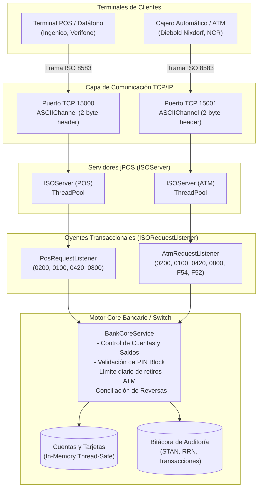
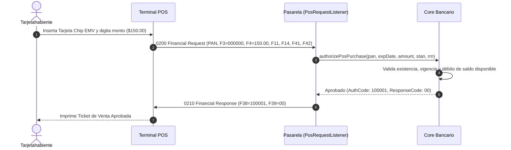
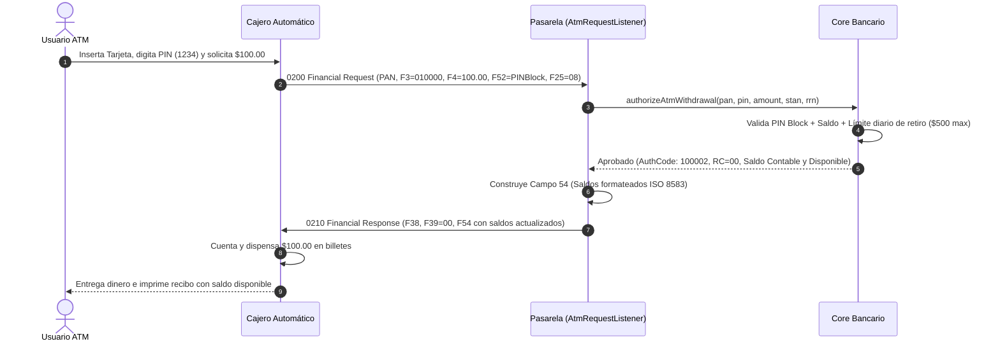
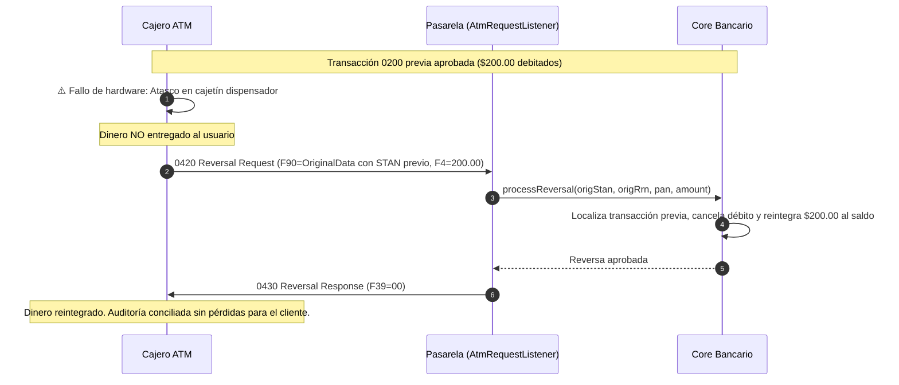

# Documentación Técnica: Pasarela de Transacciones POS y ATM con ISO 8583 en Java (jPOS)

---

## 1. Introducción y Contexto de la Industria Financiera

En el ecosistema global de pagos con tarjeta de débito y crédito, millones de transacciones se realizan cada segundo entre dispositivos terminales (Datáfonos POS, Cajeros Automáticos ATM, plataformas de comercio electrónico) y los centros de procesamiento de los bancos emisores y adquirentes.

Para garantizar la interoperabilidad universal entre diferentes fabricantes de hardware (Ingenico, Verifone, Diebold Nixdorf, NCR) y redes de autorización financiera (Visa, Mastercard, American Express, switches locales como PROSA, Red Enlace, Transbank, Banred), la Organización Internacional de Normalización estableció el estándar **ISO 8583** (*Financial transaction card originated messages — Interchange message specifications*).

El estándar define:
1. La estructura de tramas de datos intercambiadas por la red.
2. Los formatos de los identificadores de tipo de mensaje (**MTI**).
3. Los mapas de bits (**Bitmaps**) que indican qué campos están presentes en cada mensaje.
4. El significado y formato de cada elemento de datos (**Data Elements** o Campos del 1 al 128).

---

## 2. El Framework jPOS: El Estándar Industrial en Java

**[jPOS](http://jpos.org/)** es el motor de conmutación financiera de código abierto más utilizado, maduro y probado en batalla de la industria de pagos electrónicos en Java. Creado a finales de los años 90 por Alejandro Revilla, jPOS se encarga de resolver los problemas más críticos y de bajo nivel en sistemas de misión crítica:

- **Serialización y Deserialización de Alto Rendimiento**: Convierte tramas binarias o ASCII que viajan por sockets TCP/IP en objetos Java fuertemente tipados (`ISOMsg`) y viceversa en microsegundos.
- **Abstracción de Empaquetadores (`ISOPackager`)**: Soporta múltiples dialectos y versiones de ISO 8583 (1987, 1993, 2003, AS 2805, variantes propietarias de Visa/Mastercard) mediante clases Java o esquemas XML configurables (`GenericPackager`).
- **Control de Canales de Transporte (`ISOChannel`)**: Gestiona la delimitación de tramas por sockets TCP. Como TCP es un protocolo de flujo continuo orientado a bytes sin noción de mensajes individuales, `ISOChannel` resuelve el encuadre (framing) prefijando la longitud exacta de la trama (en 2 o 4 bytes ASCII, binarios o BCD).
- **Servidores Concurrentes Multihilo (`ISOServer`)**: Acepta miles de conexiones simultáneas provenientes de terminales distribuidos y delega el procesamiento a oyentes transaccionales (`ISORequestListener`) desacoplados.

---

## 3. Anatomía del Mensaje ISO 8583

Un mensaje ISO 8583 se divide estructuralmente en tres componentes fundamentales:

```text
+-----------------------+-----------------------+---------------------------------------+
|  MTI (4 Caracteres)   | Bitmap (16/32 Chars)  | Elementos de Datos (Campos F2 a F128) |
+-----------------------+-----------------------+---------------------------------------+
```

### 3.1. Identificador de Tipo de Mensaje (MTI - Message Type Identifier)
Es un código numérico de 4 dígitos que describe el propósito y la naturaleza de la transacción:

```text
Posición 1: Versión ISO 8583
 ├── 0xxx -> ISO 8583:1987
 ├── 1xxx -> ISO 8583:1993
 └── 2xxx -> ISO 8583:2003

Posición 2: Clase del Mensaje
 ├── x1xx -> Autorización (Authorization)
 ├── x2xx -> Transacción Financiera (Financial Transaction)
 ├── x4xx -> Reversa / Anulación (Reversal)
 └── x8xx -> Gestión de Red (Network Management)

Posición 3: Función del Mensaje
 ├── xx0x -> Solicitud (Request)
 ├── xx1x -> Respuesta (Response)
 ├── xx2x -> Notificación (Advice)
 └── xx3x -> Respuesta a Notificación (Advice Response)

Posición 4: Origen de la Transacción
 ├── xxx0 -> Terminal Adquirente (Acquirer)
 ├── xxx1 -> Adquirente Repetido (Acquirer Repeat)
 └── xxx2 -> Emisor (Issuer)
```

#### Ejemplos Prácticos de MTI implementados en la Pasarela:
| MTI | Descripción | Uso en el Sistema |
| :--- | :--- | :--- |
| `0800` | Network Management Request | Petición de Echo Test / Verificación de conexión de POS o ATM. |
| `0810` | Network Management Response | Respuesta de la Pasarela confirmando estado en línea. |
| `0200` | Financial Transaction Request | Compra en POS o Retiro de Efectivo en Cajero ATM. |
| `0210` | Financial Transaction Response | Respuesta del Banco con aprobación o rechazo de fondos. |
| `0100` | Authorization Request | Pre-autorización en POS o Consulta de Saldo en ATM. |
| `0110` | Authorization Response | Respuesta con código de autorización o saldo de cuenta. |
| `0400` / `0420` | Reversal Request | Reversa por timeout o por fallo físico en dispensador de billetes de ATM. |
| `0410` / `0430` | Reversal Response | Confirmación de anulación y reintegro del dinero al cliente. |

---

### 3.2. El Mapa de Bits (Bitmap)
El Bitmap indica qué campos están presentes en la trama.
- **Bitmap Primario**: Representa los campos del 1 al 64 en 64 bits (16 caracteres hexadecimales). Si el bit 1 es `1`, indica que existe un Bitmap Secundario.
- **Bitmap Secundario**: Representa los campos del 65 al 128 (otros 16 caracteres hexadecimales).

Por ejemplo, un Bitmap hexadecimal `80200000000000000400000000000000` indica la presencia de los campos F1, F3, F70, etc. El framework jPOS calcula y deserializa automáticamente los bitmaps sin intervención manual del desarrollador.

---

## 4. Arquitectura de la Pasarela (POS & ATM Gateway)

La solución está construida sobre una arquitectura modular desacoplada:



### Componentes Principales:
1. **`IsoGatewayApplication`**: Punto de entrada principal con `@SpringBootApplication` que arranca el contexto Spring Boot 3, el servidor Tomcat en el puerto `8080` y el reporte de inicio.
2. **`IsoGatewayServerService`**: Servicio Spring (`@Service`) que implementa la interfaz `SmartLifecycle` de Spring, garantizando un arranque y apagado limpio y determinista de los sockets TCP de jPOS (`ISOServer`) en los puertos `15000` (POS) y `15001` (ATM).
3. **`PosRequestListener`**: Componente Spring (`@Component`) que implementa `ISORequestListener` de jPOS para procesar tramas originadas por terminales de venta (POS).
4. **`AtmRequestListener`**: Componente Spring (`@Component`) que procesa transacciones de cajeros automáticos, extrayendo el PIN block del Campo 52 y generando la respuesta con los saldos desglosados en el Campo 54.
5. **`BankCoreService`**: Servicio Spring (`@Service`) que simula el sistema central bancario (Core Banking). Valida fondos, tarjetas vencidas o bloqueadas, límites diarios de retiro en cajeros y gestiona la auditoría para la conciliación de reversas.
6. **Capa Controladores REST (`@RestController`)**:
   - `GatewayStatusController`: Métricas en vivo del Switch (`/api/status`) y pruebas de conectividad de red con Echo 0800 (`/api/echo`).
   - `AccountController`: Consulta de cuentas (`/api/accounts`), restauración de saldos (`/api/accounts/reset`) y actualización en vivo del estado de tarjetas (`/api/accounts/status`).
   - `TransactionController`: Auditoría transaccional (`/api/transactions`).
   - `PosTransactionController`: Transacciones de compra y pre-autorización POS (`/api/pos/transact`) mediante sockets TCP directos.
   - `AtmTransactionController`: Retiros y consultas de saldo ATM (`/api/atm/transact`) con armado de PIN Block binario y balance F54.
7. **`IsoMsgHelper`**: Provee enmascaramiento de tarjetas bajo norma PCI-DSS (`453200******0001`), generación secuencial de STAN y RRN, empaquetado de PIN Block y visualización formateada de tramas.
8. **`TerminalPrinter`**: Formatea e imprime los tickets de compra y comprobantes de cajero en consola.
9. **Dashboard Web SPA (HTML5/TailwindCSS)**: Interfaz gráfica moderna servida nativamente desde `src/main/resources/static/index.html` con kioscos interactivos animados de POS y ATM.

---

## 5. Flujos Transaccionales y Diagramas de Secuencia

### 5.1. Flujo de Compra en Terminal POS (Purchase 0200 -> 0210)


---

### 5.2. Flujo de Retiro de Efectivo en Cajero ATM (0200 -> 0210 con Campo 54)


---

### 5.3. Flujo de Reversa por Falla de Dispensador Mecánico de ATM (0420 -> 0430)
En los cajeros automáticos reales, existe la posibilidad de que tras ser aprobado el débito en el banco, el mecanismo de transporte de billetes sufra un atasco o el cliente tarde más de 30 segundos en retirar el efectivo de la ranura (shutter timeout). En este escenario crítico, **el cliente no recibió su dinero**, por lo que el cajero debe emitir una **Reversa Automática (0420)**:



---

## 6. Catálogo de Campos ISO 8583 Implementados

A continuación se detalla la especificación técnica de los campos utilizados en la pasarela:

| Campo (Fld) | Nombre Técnico | Tipo / Formato jPOS | Longitud | Presencia POS | Presencia ATM | Descripción de Negocio |
| :---: | :--- | :--- | :---: | :---: | :---: | :--- |
| **MTI** | Message Type Identifier | `IFA_NUMERIC` | 4 | Sí | Sí | Identificador de tipo de mensaje (`0100`, `0200`, `0420`, `0800`). |
| **F1** | Bitmap Primario | `IFA_BITMAP` | 16 | Sí | Sí | Mapa de bits en hexadecimal indicando campos activos. |
| **F2** | Primary Account Number (PAN) | `IFA_LLNUM` | LL..19 | Sí | Sí | Número de tarjeta de 16 a 19 dígitos. |
| **F3** | Processing Code | `IFA_NUMERIC` | 6 | Sí | Sí | Código de procesamiento: `000000` (Compra), `010000` (Retiro), `300000` (Saldo). |
| **F4** | Transaction Amount | `IFA_NUMERIC` | 12 | Sí | Sí | Monto en centavos (ej. $150.00 = `000000015000`). |
| **F7** | Transmission Date & Time | `IFA_NUMERIC` | 10 | Sí | Sí | Fecha/Hora GMT de transmisión (`MMDDhhmmss`). |
| **F11** | Systems Trace Audit Number (STAN) | `IFA_NUMERIC` | 6 | Sí | Sí | Número secuencial de auditoría único por terminal. |
| **F12** | Local Transaction Time | `IFA_NUMERIC` | 6 | Sí | Sí | Hora local de la transacción (`hhmmss`). |
| **F13** | Local Transaction Date | `IFA_NUMERIC` | 4 | Sí | Sí | Fecha local de la transacción (`MMDD`). |
| **F14** | Card Expiration Date | `IFA_NUMERIC` | 4 | Sí | No | Fecha de caducidad de la tarjeta (`YYMM`, ej. `2812`). |
| **F22** | Point of Service Entry Mode | `IFA_NUMERIC` | 3 | Sí | Sí | Modo de lectura: `021` (Chip EMV), `012` (Banda), `051` (Contactless). |
| **F25** | Point of Service Condition Code | `IFA_NUMERIC` | 2 | Sí | Sí | `00` (Normal en POS), `08` (Cajero Automático / ATM). |
| **F37** | Retrieval Reference Number (RRN) | `IF_CHAR` | 12 | Sí | Sí | Clave única de rastreo para conciliación bancaria. |
| **F38** | Authorization Identification Resp | `IF_CHAR` | 6 | Sí | Sí | Código de aprobación de 6 dígitos generado por el emisor. |
| **F39** | Response Code | `IF_CHAR` | 2 | Sí | Sí | Código de respuesta (`00` Aprobado, `51` Fondos insuficientes, etc.). |
| **F41** | Card Acceptor Terminal ID (TID) | `IF_CHAR` | 8 | Sí | Sí | Identificador único de la terminal (`POS00001`, `ATM00001`). |
| **F42** | Card Acceptor Identification (MID) | `IF_CHAR` | 15 | Sí | Sí | Código del comercio o institución adquirente. |
| **F49** | Transaction Currency Code | `IF_CHAR` | 3 | Sí | Sí | Código ISO 4217 de moneda (`840` USD, `484` MXN). |
| **F52** | PIN Data (PIN Block) | `IFA_BINARY` | 8 bytes | Opcional | **Obligatorio** | Bloque criptográfico del PIN (64 bits / 16 caracteres hexadecimales). |
| **F54** | Additional Amounts (Saldos) | `IFA_LLLCHAR` | LLL..120 | No | **Obligatorio** | Saldos contable y disponible devueltos por el ATM. |
| **F70** | Network Management Code | `IFA_NUMERIC` | 3 | Sí | Sí | Código de gestión de red: `301` (Echo Test). |
| **F90** | Original Data Elements | `IF_CHAR` | 42 | Sí | Sí | Datos de la transacción original usados en Reversas (`0420`). |

---

### 6.1. Estructura Oficial del Campo 54 (Additional Amounts / Saldos)
El Campo 54 transmite los saldos de la cuenta bancaria hacia el cajero ATM. Cada saldo se compone de un segmento de 20 caracteres:

```text
[Tipo Cuenta (2)] [Tipo Saldo (2)] [Moneda (3)] [Signo (1)] [Monto en centavos (12)]
```
- **Tipo de Cuenta**: `10` (Ahorros), `20` (Corriente).
- **Tipo de Saldo**: `01` (Saldo Contable / Ledger), `02` (Saldo Disponible / Available).
- **Signo**: `C` (Crédito / Saldo positivo), `D` (Débito / Sobregiro).
- **Monto**: 12 dígitos rellenados con ceros a la izquierda.

**Ejemplo devuelto por la pasarela para $1,400.00:**
```text
1001840C000000140000 1002840C000000140000
└──────┬───────────┘ └──────┬───────────┘
   Saldo Contable      Saldo Disponible
```

---

### 6.2. Catálogo de Códigos de Respuesta (Campo 39)
| Código | Significado | Explicación Técnica |
| :---: | :--- | :--- |
| **`00`** | **Approved** | Transacción autorizada exitosamente. |
| **`05`** | **Do Not Honor** | Tarjeta bloqueada preventivamente o rechazo general. |
| **`14`** | **Invalid Card Number** | El número de tarjeta (PAN) no existe en la base del banco. |
| **`51`** | **Insufficient Funds** | La cuenta no cuenta con saldo disponible suficiente para el débito. |
| **`54`** | **Expired Card** | La fecha de expiración (YYMM) es anterior a la fecha actual. |
| **`55`** | **Incorrect PIN** | El PIN Block enviado en el Campo 52 no coincide con el registrado. |
| **`61`** | **Exceeds Withdrawal Limit** | La solicitud supera el límite diario de retiro en cajeros automáticos. |
| **`68`** | **Response Received Too Late** | Tiempo de espera agotado (Timeout de conexión). |
| **`91`** | **Issuer Switch Inoperative** | El banco emisor o enlace interbancario no responde. |
| **`96`** | **System Error** | Error de formato en la trama ISO 8583 o excepción no controlada. |

---

## 7. Consideraciones de Seguridad Bancaria y Producción

En un despliegue bancario real de producción, la arquitectura implementada en este proyecto se complementa con los siguientes mecanismos de seguridad:

### 7.1. Cumplimiento de la Norma PCI-DSS
- **Enmascaramiento de PAN**: El PAN nunca debe imprimirse ni registrarse en texto completo en logs de auditoría. Solo se exponen los primeros 6 dígitos (BIN) y los últimos 4 dígitos (`453200******0001`), tal como lo implementa [`IsoMsgHelper.maskPan()`](file:///c:/Users/Anthony/Desktop/8vo%20semestre/Desarrollo%20Web/Java%20JPOS%20PROYECTO/src/main/java/com/fintech/iso8583/gateway/util/IsoMsgHelper.java).
- **Prohibición de Almacenamiento de Datos Sensibles**: Queda estrictamente prohibido persistir datos de la pista magnética completa (Track 2, F35), el código de seguridad (CVV2/CVC2) o el PIN Block.

### 7.2. Módulos de Seguridad de Hardware (HSM - Hardware Security Modules)
En producción, el Core Bancario no valida los PINs directamente en memoria con código Java. En su lugar, se integra con un dispositivo criptográfico físico certificado FIPS 140-2 Nivel 3 (como **Thales payShield 10K** o **Utimaco Atalla**):
1. El POS o ATM cifra el PIN en el teclado físico usando una llave de trabajo (**TPK** - Terminal PIN Key).
2. La pasarela recibe el PIN Block y le envía un comando al HSM para **traducción de PIN** (traduce de la llave de terminal TPK a la llave de zona **ZPK** de la red).
3. El Core valida el PIN Offset o el hash PVV generado por el emisor dentro de la memoria segura del HSM sin exponer jamás el PIN en texto plano.

### 7.3. Cifrado de Canal de Transporte
Las conexiones TCP entre los datáfonos/cajeros y la pasarela jPOS deben estar protegidas mediante:
- **TLS 1.3 con Autenticación Mutua (mTLS)**: Tanto el servidor jPOS como la terminal POS/ATM presentan certificados digitales X.509 para autenticarse mutuamente, evitando ataques de hombre en el medio (MITM) o suplantación de terminales.

### 7.4. Datos del Chip EMV (Campo 55)
Para tarjetas con chip inteligente, la terminal lee los tags criptográficos EMV (Tag 9F26 Criptograma de Aplicación ARQC, Tag 82 AIP, Tag 9F36 ATC) y los empaqueta en el Campo 55 en formato TLV (*Tag-Length-Value*). El switch retransmite estos tags al emisor para verificar la autenticidad física del microcircuito de la tarjeta contra clonaciones.

---

## 8. Verificación y Resultados de Pruebas

El proyecto cuenta con una suite completa de pruebas unitarias y de integración en [`GatewayIntegrationTest.java`](file:///c:/Users/Anthony/Desktop/8vo%20semestre/Desarrollo%20Web/Java%20JPOS%20PROYECTO/src/test/java/com/fintech/iso8583/gateway/GatewayIntegrationTest.java):

```text
[INFO] Running com.fintech.iso8583.gateway.GatewayIntegrationTest
[INFO] Tests run: 11, Failures: 0, Errors: 0, Skipped: 0, Time elapsed: 1.975 s
[INFO] BUILD SUCCESS
```

### Casos de Prueba Verificados:
1. `testPosEcho`: Verifica handshake de red 0800 -> 0810 en canal POS.
2. `testPosPurchaseApproved`: Compra de $100.00 con tarjeta activa (0200 -> 0210, RC=00).
3. `testPosPurchaseInsufficientFunds`: Compra rechazada por fondos insuficientes (0200 -> RC=51).
4. `testPosPurchaseExpiredCard`: Compra rechazada por tarjeta vencida (0200 -> RC=54).
5. `testPosPurchaseReversal`: Compra seguida de reversa 0420 con validación del reintegro de saldo.
6. `testAtmEcho`: Handshake de red 0800 -> 0810 en canal ATM.
7. `testAtmBalanceInquiry`: Consulta de saldo 0100 -> 0110 con verificación del Campo 54.
8. `testAtmWithdrawalApproved`: Retiro de efectivo de $50.00 (0200 -> 0210) con actualización de saldos.
9. `testAtmWithdrawalWrongPin`: Retiro rechazado por PIN incorrecto (RC=55).
10. `testAtmWithdrawalExceedsDailyLimit`: Retiro de $999.00 rechazado por superar límite diario de $500.00 (RC=61).
11. `testAtmDispenserFailureReversal`: Simulación de atasco en dispensador de billetes de ATM con reversa automática 0420 y restauración del balance.

---

## 9. Arquitectura Headless REST API y Colección de Postman

La solución opera como un **Backend Transaccional Headless (Sin interfaz gráfica visual)**, exponiendo una API RESTful completa en JSON sobre Spring Boot 3 que se conecta a los sockets TCP de jPOS.

### 9.1. ¿Cómo se comunican los Endpoints REST y los Sockets ISO 8583?
Los controladores Spring Boot (`PosTransactionController`, `AtmTransactionController`) actúan como pasarelas de enlace:
1. Una aplicación cliente (Postman, microservicio o backend adquirente) envía una petición HTTP POST a un endpoint como `/api/pos/purchase` o `/api/atm/withdrawal`.
2. El controlador Spring Boot abre un socket TCP local contra el puerto `15000` (POS) o `15001` (ATM) usando `ASCIIChannel` de jPOS.
3. Se serializa la trama real `ISOMsg` conforme al estándar ISO 8583:1987, se transmite por TCP al `ISOServer`, y el `RequestListener` procesa la lógica bancaria debitando o consultando el `BankCoreService`.
4. El servidor emite la respuesta `0210` / `0110` / `0430` a través del socket.
5. El controlador traduce la trama ISO recibida en un JSON estructurado de alta fidelidad que incluye el código de respuesta (F39), código de autorización (F38), balances (F54), y el desglose de cada campo ISO transmitido y recibido.

### 9.2. Colección Oficial de Postman (`postman_collection.json`)
El archivo [`postman_collection.json`](file:///c:/Users/Anthony/Desktop/8vo%20semestre/Desarrollo%20Web/Java%20JPOS%20PROYECTO/postman_collection.json) en la raíz del repositorio incluye 22 peticiones organizadas con nombres fáciles e intuitivos en español:
1. **01 - Probar Conexión y Diagnóstico (Echo 0800)**: Directorio de endpoints, estado del switch con métricas y Echo tests de datáfono y cajero sobre TCP.
2. **02 - Tarjetas y Cuentas (Saldos y Bloqueos)**: Listar tarjetas, consultar saldo por PAN, bloquear tarjeta (RC 05), desbloquear tarjeta, vencer tarjeta (RC 54) y reiniciar a saldos originales.
3. **03 - Pagos con Datáfono (POS - Compras 0200 y Respuestas 0210)**: Compra exitosa aprobada con código de autorización en F38, rechazo por falta de dinero (RC 51), rechazo por tarjeta vencida (RC 54), rechazo por tarjeta bloqueada (RC 05), preautorización de hotel/auto (0100) y anulación/reversa por fallo de papel en impresora (0420).
4. **04 - Cajero Automático (ATM - Retiros con PIN y Saldos)**: Consultar saldo en pantalla con Campo 54, retirar efectivo exitoso con clave PIN criptográfica (F52), rechazo por PIN incorrecto (RC 55), rechazo por límite diario (RC 61), rechazo por falta de saldo (RC 51) y anulación/reversa por atasco de billetes en dispensador (0420).
5. **05 - Historial y Auditoría de Operaciones**: Bitácora transaccional completa y búsqueda por RRN/STAN.

---

## 10. Nombres Fáciles en Español y Catálogo Oficial en PDF (MTI 0210)

### 10.1. Directorio de Rutas REST Fáciles en Español
Para máxima simplicidad y legibilidad en entornos en español, se habilitaron rutas amigables en todos los controladores Spring Boot:

| Acción Transaccional | Ruta Fácil en Español | Ruta Técnica Estándar | Trama ISO 8583 |
| :--- | :--- | :--- | :--- |
| **Probar Conexión Datáfono** | `GET /api/conexion?channel=POS` | `GET /api/echo?channel=POS` | MTI 0800 &rarr; 0810 |
| **Probar Conexión Cajero** | `GET /api/conexion?channel=ATM` | `GET /api/echo?channel=ATM` | MTI 0800 &rarr; 0810 |
| **Ver Estado y Métricas** | `GET /api/estado` | `GET /api/status` | Métricas en Memoria |
| **Ver Todas las Cuentas** | `GET /api/cuentas` | `GET /api/accounts` | Core Emisor |
| **Consultar Saldo por Tarjeta** | `GET /api/cuentas/{pan}` | `GET /api/accounts/{pan}` | Core Emisor |
| **Cambiar Estado (Bloquear)** | `POST /api/cuentas/cambiar-estado` | `POST /api/accounts/status` | Core Emisor |
| **Restaurar Saldos de Fábrica** | `POST /api/cuentas/restaurar` | `POST /api/accounts/reset` | Core Emisor |
| **Compra en Datáfono** | `POST /api/pos/compra` | `POST /api/pos/purchase` | MTI 0200 &rarr; **0210 (RC 00)** |
| **Preautorización POS** | `POST /api/pos/preautorizacion` | `POST /api/pos/preauth` | MTI 0100 &rarr; 0110 |
| **Anular Compra (Reversa)** | `POST /api/pos/anular` | `POST /api/pos/reversal` | MTI 0420 &rarr; 0430 |
| **Consultar Saldo en Cajero** | `POST /api/atm/consultar-saldo` | `POST /api/atm/inquiry` | MTI 0100 &rarr; 0110 (F54) |
| **Retirar Dinero en Cajero** | `POST /api/atm/retiro` | `POST /api/atm/withdrawal` | MTI 0200 &rarr; **0210 (RC 00/F54)** |
| **Anular Retiro por Atasco** | `POST /api/atm/anular` | `POST /api/atm/reversal` | MTI 0420 &rarr; 0430 (F90) |
| **Ver Historial de Auditoría** | `GET /api/historial` | `GET /api/transactions` | Auditoría Transaccional |

### 10.2. Catálogo Oficial en PDF: Transacciones Tipo 0210
Se incluye en la raíz del repositorio el documento generado:
👉 [`Catalogo_Transacciones_ISO8583_0210.pdf`](file:///c:/Users/Anthony/Desktop/8vo%20semestre/Desarrollo%20Web/Java%20JPOS%20PROYECTO/Catalogo_Transacciones_ISO8583_0210.pdf)

Este documento PDF de alta calidad editorial contiene:
1. **Anatomía del MTI 0210**: Explicación de los 4 dígitos (Versión 1987, Financiero, Respuesta, Adquirente).
2. **Listado Exhaustivo de las 10 Transacciones 0210 y Qué Hace Cada Una**: Compras estándar (F3 `000000`), Retiros en ATM (F3 `010000`), Compras con Cash-back (`090000`), Avances de Efectivo (`013000`), Reembolsos (`200000`), Recaudos de Servicios Públicos (`500000`), Transferencias (`401020`), Depósitos en cajero (`210000`), Recargas electrónicas (`280000`) y Autorizaciones forzadas offline.
3. **Campos ISO 8583 en la Trama 0210**: Desglose de F2 a F54 con su formato, reglas de negocio y presencia.
4. **Estructura Interna del Campo 54**: Desglose de saldos contable y disponible de 20 caracteres por saldo en cajeros automáticos.
5. **Diccionario Completo del Campo 39 (Action Codes)**: Explicación de los 19 códigos de respuesta más comunes en la banca (`00`, `01`, `04`, `05`, `12`, `14`, `30`, `41`, `43`, `51`, `54`, `55`, `58`, `61`, `65`, `68`, `75`, `91`, `96`).
6. **Mecanismos de Reversa 0420 / 0430**: Flujo de compensación ante atasco de billetes en ATM o fallo de papel en datáfono, y anatomía del Campo 90 (*Original Data Elements*).
7. **Ejemplos Reales de Tramas Decodificadas**: Tramas 0200 y 0210 de compra en POS y retiro en ATM con PIN Block y balances.

