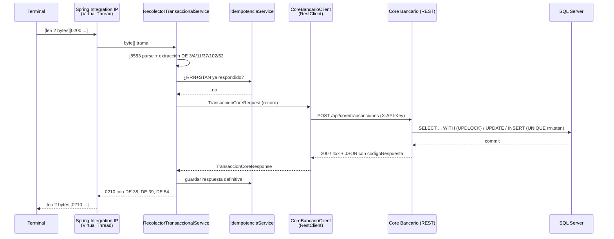

# Reporte técnico: Recolector Transaccional ISO 8583

Documento de diseño y resultados del proyecto. Para instalar y ejecutar, ver el [README](README.md); para el uso del cajero, el **Manual de Usuario** (`MANUAL_DE_USUARIO_RED_NEXUS.pdf`), y para la referencia de operación y API, el **Manual Técnico** (`MANUAL_TECNICO_RED_NEXUS_ISO8583.pdf`).

## Contenido

1. [Alcance](#1-alcance)
2. [Arquitectura y decisiones de diseño](#2-arquitectura-y-decisiones-de-diseño)
3. [Formato de las tramas](#3-formato-de-las-tramas)
4. [Core Bancario](#4-core-bancario)
5. [Seguridad](#5-seguridad)
6. [Mediciones y metodología](#6-mediciones-y-metodología)
7. [Estrategia de pruebas](#7-estrategia-de-pruebas)
8. [Limitaciones y trabajo futuro](#8-limitaciones-y-trabajo-futuro)

---

## 1. Alcance

El sistema cumple el rol de **switch / recolector transaccional** entre terminales (cajeros y POS) que hablan **ISO 8583:1987** sobre TCP y un **Core Bancario** que expone una API REST/JSON sobre SQL Server. Ambos componentes viven en la misma aplicación Spring Boot, pero se comunican **solo por HTTP** (el Recolector llama al Core con `RestClient` como si fuera un servicio remoto), de modo que podrían desplegarse por separado sin cambiar código.

Transacciones soportadas:

| MTI solicitud → respuesta | Uso | DE 3 (código de procesamiento) |
|---|---|---|
| 0200 → 0210 | Financiera: compra, retiro, devolución, transferencia | `00xxxx` compra, `01xxxx` retiro, `20xxxx` devolución, `40xxxx` transferencia (cuenta destino en DE 103) |
| 0100 → 0110 | Autorización / consulta de saldo | `30xxxx` |
| 0420 → 0430 | Reversa de una transacción aprobada (DE 37 = RRN original) | el de la transacción original |
| 0800 → 0810 | Gestión de red / echo test (DE 70 = 301) | — |

---

## 2. Arquitectura y decisiones de diseño



### 2.1 Servidor TCP: Spring Integration IP + Virtual Threads

- `TcpNetServerConnectionFactory` con `ByteArrayLengthHeaderSerializer(HEADER_SIZE_UNSIGNED_SHORT)`: el enmarcado bancario habitual (2 bytes con la longitud). Un tamaño máximo de trama (`recolector.tcp.max-frame-bytes`) evita que una longitud maliciosa reserve memoria arbitraria.
- `Tcp.inboundGateway`: la respuesta sale por la misma conexión, que puede quedar abierta (las terminales reales mantienen la sesión).
- El ejecutor de la fábrica es un `SimpleAsyncTaskExecutor` con **Virtual Threads**: cada conexión se atiende en su propio hilo virtual y todo el código es **bloqueante y secuencial** (lectura del socket, llamada HTTP, JDBC). Con miles de terminales no se agotan hilos de plataforma y no hace falta programación reactiva.
- `spring.threads.virtual.enabled=true` aplica lo mismo a Tomcat y a las tareas programadas.
- Sin `synchronized` en rutas con E/S (se usa `ReentrantLock` donde hace falta exclusión) para no fijar (*pin*) el hilo virtual a su carrier. La prueba `LoadTestSimulationTest` lo verifica con el evento JFR `jdk.VirtualThreadPinned`.
- `TcpIsoHealthIndicator` publica en `/actuator/health` si el socket está escuchando y cuántas conexiones hay abiertas.

### 2.2 Motor ISO 8583 (j8583)

- `j8583.xml` define una guía de parseo por MTI. Cada respuesta declara todos los campos que puede devolver, y `IsoMessageService.createResponse` elimina de la respuesta cualquier campo que no esté en su guía y el PIN block (DE 52): la terminal siempre puede parsear la respuesta y el PIN nunca regresa.
- `GuiasMessageFactory` expone las guías de parseo para saber qué campos admite cada respuesta.
- Una trama ilegible (bitmap inválido, longitudes incoherentes o un MTI sin guía de parseo) no cierra la conexión: se responde una trama válida con **DE 39 = 30**. Un MTI que se puede leer pero no es una solicitud soportada responde **12**, y un error inesperado **96**.

### 2.3 Adaptador hacia el Core: RestClient + RetryTemplate

- `CoreBancarioClient` usa `RestClient` (Spring Framework 7) sobre un pool de conexiones **Apache HttpClient 5** (keep-alive, 500 conexiones), adecuado para E/S bloqueante en Virtual Threads.
- Inyección con `jakarta.inject` (`@Named`, `@Inject`); DTO inmutables con `record` y validación `jakarta.validation`.
- Reintentos con el `RetryTemplate` **del núcleo de Spring Framework 7** (`org.springframework.core.retry`), solo ante caída de conexión o HTTP 5xx, con espera exponencial. Reintentar es seguro porque el Core es idempotente por (RRN, STAN).
- Traducción de fallos a DE 39: timeout → **68**, sin conexión / 5xx → **91**, respuesta ilegible → **96**; si el Core responde 4xx con cuerpo, se usa su `codigoRespuesta` exacto; sin cuerpo, se traduce el estado HTTP (`codigoPorEstadoHttp`).

### 2.4 Idempotencia en dos niveles

1. **Recolector (`IdempotenciaService`):** caché en memoria por `RRN:STAN` con expiración (60 minutos) y tamaño máximo (50.000 entradas). Una retransmisión de la terminal recibe exactamente la misma trama sin llamar al Core. Los errores transitorios (68, 91, 96) **no** se guardan para que la retransmisión vuelva a intentarse.
2. **Core (`CoreBancarioService`):** restricción `UNIQUE(rrn, stan)` en `transacciones`. Si llegan dos solicitudes iguales a la vez, la segunda falla al insertar, su transacción de BD se revierte completa (incluido el débito) y se devuelve la respuesta de la primera. Así la garantía no depende de la caché ni de que haya una sola instancia del Recolector.

### 2.5 Imagen nativa y Distroless

- Compilación AOT de Spring + GraalVM Native Image 25 (perfil Maven `native`), con `--static-nolibc` (todo estático salvo glibc) para correr sobre `distroless/cc-debian12`, `-march=compatibility` para que el binario funcione en cualquier x86-64 y `-H:+AddAllCharsets` (el driver de SQL Server necesita `Cp1252`).
- `IsoAotRuntimeHints` (`RuntimeHintsRegistrar`, registrado en `META-INF/spring/aot.factories`) declara la reflexión que j8583 hace sobre sus tipos y los recursos `j8583.xml` y su DTD.
- Distroless no tiene shell ni `curl`: el `HEALTHCHECK` ejecuta `/app/recolector --healthcheck`, un modo del propio binario que consulta `/actuator/health` y termina con 0 o 1 sin levantar Spring.
- Para un arranque rápido, Hibernate no consulta metadatos JDBC al iniciar (`hibernate.boot.allow_jdbc_metadata_access=false`, dialecto y versión de BD declarados) y Hikari no abre conexiones hasta la primera consulta (`initialization-fail-timeout: -1`); la contraseña del administrador se hashea con BCrypt en el primer login, no al arrancar.

---

## 3. Formato de las tramas

### 3.1 Enmarcado

```
+----------------+---------------------+--------+---------------------------+-----------------------+
| longitud (2 B) | cabecera (opcional) | MTI    | bitmap(s) en hexadecimal  | campos en ASCII       |
| big-endian     | "ISO015000050"      | "0200" | 16 o 32 caracteres        | según j8583.xml       |
+----------------+---------------------+--------+---------------------------+-----------------------+
```

El bitmap secundario aparece cuando hay campos > 64 (DE 70, 90, 102, 103). La longitud no incluye los 2 bytes del prefijo.

### 3.2 Campos usados

| DE | Nombre | Formato | Uso |
|---|---|---|---|
| 2 | PAN | LLVAR | Tarjeta; también sirve para buscar la cuenta si no viene DE 102 |
| 3 | Código de procesamiento | n6 | Tipo de operación (ver sección 1) |
| 4 | Monto | n12 (centavos) | Monto de la transacción |
| 7 | Fecha y hora de transmisión | MMddHHmmss | |
| 11 | STAN | n6 | Idempotencia (con DE 37) |
| 12 / 13 | Hora / fecha local | HHmmss / MMdd | |
| 37 | RRN | an12 | Idempotencia; en 0420, RRN de la transacción a reversar |
| 38 | Código de autorización | an6 | Solo en respuestas aprobadas |
| 39 | Código de respuesta | an2 | Ver 3.3 |
| 41 / 42 | Terminal / comercio | an8 / an15 | |
| 49 | Moneda | n3 | 320 (GTQ) por defecto, 840 (USD) |
| 52 | PIN block | an16 (hex) | ISO 9564 formato 0 (ver 3.4) |
| 54 | Saldos | LLLVAR | Ver 3.5 |
| 70 | Código de gestión de red | n3 | 301 = echo test |
| 90 | Datos originales | an42 | Reversas |
| 102 / 103 | Cuenta origen / destino | LLVAR | Transferencias usan DE 103 |

### 3.3 Códigos de respuesta (DE 39) y su origen

| DE 39 | Significado | HTTP del Core | Origen |
|---|---|---|---|
| 00 | Aprobada | 200 | Core |
| 05 | Tarjeta bloqueada / no honrar | 403 | Core (estado `BLOCKED`) |
| 12 | Transacción inválida / MTI o DE 3 no soportado | 400 | Recolector o Core |
| 13 | Monto inválido | 400 | Core |
| 14 | Cuenta o tarjeta inexistente | 404 | Core |
| 25 | Transacción original no encontrada (reversa) | 404 | Core |
| 30 | Error de formato | 400 | Recolector (trama ilegible o sin DE obligatorios) o Core (JSON inválido) |
| 51 | Fondos insuficientes | 422 | Core |
| 54 | Tarjeta vencida | 410 | Core (estado `EXPIRED`) |
| 55 | PIN incorrecto o ausente | 403 | Core |
| 61 | Excede el límite diario | 429 | Core |
| 68 | Tiempo de espera agotado | — | Recolector (timeout del RestClient) |
| 75 | Excede los intentos de PIN (la tarjeta se bloquea) | 403 | Core (3 intentos) |
| 91 | Emisor / host no disponible | 5xx o sin conexión | Recolector |
| 96 | Error del sistema | — | Recolector |

### 3.4 PIN block ISO 9564 formato 0 (DE 52)

```
PIN 1234, PAN 4532000000000001
bloque PIN = 0 | longitud | PIN | relleno F                -> 041234FFFFFFFFFF
bloque PAN = 0000 | 12 dígitos del PAN sin el verificador  -> 0000200000000000
DE 52      = bloque PIN XOR bloque PAN                     -> 041214FFFFFFFFFF
```

El Core recupera el PIN con el PAN de la cuenta y lo compara en tiempo constante contra `SHA-256("numeroCuenta:PIN")`. En producción el bloque viajaría cifrado bajo una ZPK y se verificaría dentro de un HSM; aquí viaja en claro para poder demostrar la validación de extremo a extremo.

### 3.5 Saldos (DE 54)

Dos bloques de 20 caracteres: tipo de cuenta (`10`), tipo de monto (`01` contable, `02` disponible), moneda (DE 49), signo (`C` crédito / `D` débito) y 12 dígitos en centavos. Ejemplo para Q1,400.00: `1001320C0000001400001002320C000000140000`.

---

## 4. Core Bancario

Tablas (`init_sqlserver.sql`; el script es idempotente: crea lo que falta sin borrar datos, y si encuentra una columna `pin` en claro la convierte a `pin_hash` y la elimina):

- `cuentas`: número de cuenta (único), PAN, titular, saldos disponible y contable, límite diario, retirado hoy y fecha del último retiro, estado (`ACTIVE`, `BLOCKED`, `EXPIRED`), `pin_hash`, intentos de PIN fallidos, banco.
- `transacciones`: RRN, STAN (`UNIQUE(rrn, stan)`), cuentas, monto, tipo, saldos antes y después, DE 39, autorización, terminal, fecha. Índices: número de cuenta (único), PAN, `(rrn, stan)` único, cuenta y RRN de las transacciones.

Reglas:

- **Concurrencia:** la fila de la cuenta se lee con bloqueo pesimista (`UPDLOCK, HOLDLOCK, ROWLOCK` en SQL Server). En transferencias se bloquean ambas cuentas **en orden de id** para evitar interbloqueos. La BD usa `READ_COMMITTED_SNAPSHOT` para que las consultas no esperen a los débitos.
- **Validaciones en orden:** cuenta existente (14) → estado (05/54) → PIN si la operación lo exige o si viene (55/75) → monto (13) → límite diario de retiro (61) → saldo (51).
- **PIN obligatorio** en retiros, consultas y transferencias. Un PIN correcto reinicia los intentos; el tercero fallido bloquea la tarjeta.
- **Reversa:** busca la transacción original aprobada por RRN, acredita su monto (y revierte el acumulado diario si era retiro) una sola vez; si no existe responde 25.
- **Rendimiento en SQL Server:** `sendStringParametersAsUnicode=false` (los parámetros `VARCHAR` usan los índices con *seek* en vez de *scan*), una sola consulta para buscar y bloquear la cuenta, y la idempotencia delegada a la restricción única en lugar de una consulta previa.

---

## 5. Seguridad

| Superficie | Control |
|---|---|
| `POST /api/core/transacciones` | Solo el Recolector (cabecera `X-API-Key`, comparación en tiempo constante) o un administrador |
| Altas, ediciones, recargas, bloqueos, borrados, reset, `/actuator/metrics` | Rol `ADMIN` con HTTP Basic (usuario/contraseña por variables de entorno, BCrypt) |
| Interfaz web | El login se valida contra `/api/core/admin/sesion`; las credenciales solo viven en memoria de la pestaña; un 401 cierra la sesión |
| PIN | Nunca se guarda ni se devuelve en claro: hash SHA-256 en BD, PIN block en la trama, eliminado de las respuestas |
| API | Sin sesión ni cookies (stateless), por eso CSRF no aplica; respuestas 401 sin `WWW-Authenticate` para que el navegador no muestre su diálogo nativo |
| Contenedor | Distroless sin shell, usuario `nonroot` (65532), solo el binario |

---

## 6. Mediciones y metodología

### 6.1 Entorno

- 4 vCPU compartidas, 15 GB de RAM, Linux. La aplicación, **SQL Server 2022 (Docker)** y el generador de carga (**JMeter 5.6.3 sobre Java 21**) corren en la misma máquina, por lo que compiten por la CPU.
- Binario nativo: GraalVM CE 25.0.2, Serial GC, sin opciones de memoria (salvo donde se indica).
- JVM: GraalVM JDK 25.0.2 en modo JVM, `-XX:+UseZGC -Xmx1g` (ZGC generacional, el único modo desde JDK 24).

### 6.2 Arranque y memoria

- **Arranque:** valor de `Started RecolectorApplication in X seconds` en tres ejecuciones consecutivas, con SQL Server ya disponible.
- **RSS:** `VmRSS` de `/proc/<pid>/status` tras arrancar, y el máximo muestreado cada segundo durante la prueba de carga.

| | Nativo | JVM |
|---|---|---|
| Arranque | 0,54 s · 0,51 s · 0,60 s (0,73 s el más lento observado) | 8,9 s (21 s con caché de disco fría) |
| RSS tras arrancar | 250-251 MB (114 MiB según `docker stats` en el contenedor) | 930 MB |
| RSS máximo bajo carga | 708 MB (sin límite de heap) · 492 MB con `-Xmx256m` | 1.361 MB |

El arranque nativo está distribuido entre ~480 beans (perfil por bean con el log de `DefaultListableBeanFactory`): ningún componente domina; los mayores son la creación del `DataSource` (~50 ms), los endpoints de Actuator (~45 ms), Spring Integration (~40 ms) y Spring MVC (~40 ms). La inicialización diferida (`spring.main.lazy-initialization=true`) solo lo bajó a ~0,40-0,49 s, a cambio de mover ese costo a la primera transacción, por lo que no se activó.

### 6.3 Rendimiento (TPS)

Plan `load-test-iso8583.jmx`: 100 terminales con conexión TCP persistente, rampa de 5 s, 60 s de medición, retiros 0200 de Q0.01 con PIN block (cada uno pasa por parseo, idempotencia, HTTP al Core, validación de PIN, bloqueo de fila, débito e inserción). En JVM se ejecutó antes un calentamiento de 30 s. Resultados del reporte HTML de JMeter (`statistics.json`):

| | Transacciones | Errores | TPS | Media | p90 | p95 | p99 |
|---|---|---|---|---|---|---|---|
| Nativo | 31.089 | 0 | **518,6** | 184,6 ms | 296 ms | 335 ms | 459 ms |
| Nativo `-Xmx256m` | 26.189 | 0 | 437,0 | 218,8 ms | 355 ms | 416 ms | 571 ms |
| JVM + ZGC | 30.993 | 0 | **516,4** | 185,1 ms | 261 ms | 309 ms | 419 ms |

La misma prueba lanzada como lo hará el usuario (`docker compose --profile carga run --rm jmeter`: contenedor nativo en Distroless, 200 terminales, 60 s) dio **514,0 TPS con 0 errores** (30.957 transacciones; p95 781 ms, p99 1.143 ms por la cola más larga).

Con 4 vCPU repartidas entre la app, SQL Server y JMeter la CPU queda saturada en ~520 TPS en ambos modos; las latencias reflejan la cola de 100 terminales sobre una CPU llena. **La meta de 2.000 TPS no se alcanzó en este equipo.** Para evaluarla se necesita hardware con más núcleos y, de preferencia, el generador de carga y SQL Server en máquinas separadas; el plan y la imagen Docker de JMeter están listos para repetir la medición (README, sección 6).

### 6.4 Pausas de GC y pinning

- **ZGC (modo JVM)**, registro `-Xlog:gc*` durante el calentamiento y la medición: 120 pausas, media **0,038 ms**, p99 **0,19 ms**, máxima **0,90 ms** (meta ≤ 1 ms).
- `LoadTestSimulationTest` repite la validación en cada `mvn verify`: lanza carga concurrente por TCP con un `RecordingStream` de JFR activo y falla si alguna pausa (`jdk.GarbageCollection#longestPause`) supera 1 ms o si hay eventos `jdk.VirtualThreadPinned` atribuibles al código de la aplicación (o de 20 ms o más). Última ejecución: 5.000 transacciones aprobadas, 522 TPS, pausa máxima **0,071 ms**, 1 evento de pinning interno del JDK y **0** atribuibles a la aplicación.
- **Binario nativo:** GraalVM Community solo incluye Serial GC en imágenes nativas, por lo que la meta de pausas se evalúa en modo JVM.

### 6.5 Cobertura

JaCoCo sobre la suite completa (119 pruebas, 0 fallos): **96,8 % de líneas**, **84,5 % de ramas**, 97,0 % de instrucciones y 99,6 % de métodos. `mvn verify` falla si la cobertura de líneas baja de 80 % (`jacoco:check`).

---

## 7. Estrategia de pruebas

- **Unitarias:** j8583 (parseo, codificación, bitmaps, campos variables, tramas corruptas), PIN block, catálogo de códigos, mapeo de tipo de operación, idempotencia y orquestación con dobles de prueba.
- **Integración con WireMock:** el `RestClient` contra un Core simulado: cada estado HTTP y cuerpo posible, reintentos ante 5xx y caídas, timeouts, envío de la API Key.
- **Integración con Spring (H2 en modo MSSQL):** servicio y API del Core con concurrencia real (hilos simultáneos sobre la misma cuenta sin pérdidas de actualización, duplicados simultáneos aplicados una sola vez), seguridad y validaciones.
- **Extremo a extremo:** socket TCP real → Recolector → HTTP → Core → BD, con el enmarcado de 2 bytes, keep-alive, todos los MTI y retransmisiones.
- **Carga:** `LoadTestSimulationTest` (JFR: ZGC y pinning) y el plan JMeter contra la aplicación real con SQL Server.
- **Interfaz web:** flujo del cajero y del administrador verificado en Chromium (Playwright) contra la aplicación real: PIN incorrecto → 55 → reingreso, retiro, reversa, estado de cuenta, login validado por el servidor, alta/edición de PIN/borrado y cierre de sesión ante 401.
- **Postman:** la colección incluye pruebas automáticas y se ejecutó completa con Newman contra el binario nativo.

---

## 8. Limitaciones y trabajo futuro

- **PIN en claro dentro del PIN block:** en producción se cifraría con una ZPK y se verificaría en un HSM; el socket TCP debería ir sobre TLS (mTLS con las terminales).
- **2.000+ TPS:** no medido en hardware adecuado; pasos para escalar: más núcleos, SQL Server dedicado, varias instancias del Recolector detrás de un balanceador TCP (la idempotencia en BD lo permite), y procesar el Core en el mismo proceso cuando no se requiera el salto HTTP.
- **Arranque < 100 ms:** posible separando el Core Bancario (JPA/Hibernate) del Recolector en servicios distintos; el Recolector sin JPA tendría muchos menos beans.
- **Caché de idempotencia local:** con varias instancias del Recolector, la deduplicación rápida debería moverse a un almacén compartido (la garantía fuerte ya está en la BD).
