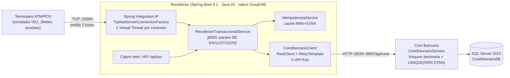

# Recolector Transaccional ISO 8583 de Alto Rendimiento

Switch transaccional que recibe tramas **ISO 8583** por **TCP**, las traduce a un **Core Bancario REST** (SQL Server) y devuelve la respuesta ISO con el código de acción en el **DE 39**. Incluye un cajero automático web para la demostración, binario nativo **GraalVM 25** sobre **Distroless**, pruebas automatizadas con cobertura **> 80 %** y un plan de carga **JMeter**.

| Componente | Versión |
|---|---|
| Java | 25 (Virtual Threads, Records, Pattern Matching) |
| Spring Boot / Framework | 4.1.2 / 7.0 (RestClient, `RetryTemplate` del core) |
| Spring Integration IP | 7.1 (servidor TCP con prefijo de longitud de 2 bytes) |
| Jakarta EE | 11 (`jakarta.inject`, `jakarta.annotation`, `jakarta.validation`, `jakarta.persistence`) |
| Motor ISO 8583 | j8583 1.17 (`j8583.xml`) |
| Base de datos | SQL Server 2022 (H2 en modo MSSQL solo para pruebas) |
| Imagen nativa | GraalVM Native Image 25 → `gcr.io/distroless/cc-debian12:nonroot` |
| GC en JVM | Generational ZGC |
| Pruebas | JUnit 6, AssertJ, Mockito, MockMvc, WireMock 3, JaCoCo, JFR |
| Carga | Apache JMeter 5.6.3 |

### Documentación del proyecto

| Documento | Contenido |
|---|---|
| `README.md` (este archivo) | Instalación con Docker, uso, arquitectura, cumplimiento de la guía, pruebas, carga y resultados |
| [`COMPILACION.md`](COMPILACION.md) | **Instrucciones de compilación y prueba**: con Docker (nativo o JVM) y sin Docker (JDK 25 + Maven, nativo en Linux), configuración y problemas frecuentes |
| [`PRUEBAS.md`](PRUEBAS.md) | **Guía de pruebas y de la defensa**: pruebas automatizadas, carga, cómo medir cada métrica y las tres demostraciones (simulador ISO en vivo, binario nativo, métricas de carga) |
| [`DOCUMENTACION.md`](DOCUMENTACION.md) | Reporte técnico: decisiones de diseño, formato de las tramas, Core Bancario, seguridad, metodología y mediciones |
| `MANUAL_DE_USUARIO_RED_NEXUS.pdf` | Manual de usuario del cajero web y del panel de administración (con capturas) |
| `MANUAL_TECNICO_RED_NEXUS_ISO8583.pdf` | Manual técnico: arquitectura, protocolo, base de datos, API REST, configuración, despliegue y operación |
| `postman_collection.json` | Colección de Postman con pruebas automáticas |
| `docs/manuales/` | Fuentes HTML y capturas de los dos manuales. Para regenerar un PDF: abrir el HTML en Chrome o Edge → Imprimir → Guardar como PDF, tamaño Carta, con **Gráficos de fondo** activado |

---

## Contenido

1. [Inicio rápido con Docker (Windows)](#1-inicio-rápido-con-docker-windows)
2. [Uso: cajero web, API, Postman y socket TCP](#2-uso-cajero-web-api-postman-y-socket-tcp)
3. [Arquitectura](#3-arquitectura)
4. [Cumplimiento de la guía del proyecto](#4-cumplimiento-de-la-guía-del-proyecto)
5. [Pruebas y cobertura](#5-pruebas-y-cobertura)
6. [Prueba de carga con JMeter](#6-prueba-de-carga-con-jmeter)
7. [Resultados medidos](#7-resultados-medidos)
8. [Ejecución sin Docker (desarrollo)](#8-ejecución-sin-docker-desarrollo)
9. [Guía para la defensa](#9-guía-para-la-defensa)
10. [Estructura del repositorio](#10-estructura-del-repositorio)

---

## 1. Inicio rápido con Docker (Windows)

Solo se necesita **Docker Desktop** (backend WSL 2, contenedores Linux). No hace falta instalar Java, Maven ni SQL Server.

```powershell
git clone https://github.com/IanB0506/Cajero-Automatico.git
cd Cajero-Automatico
docker compose up -d --build
```

**Qué versión se compila:** la elige `APP_DOCKERFILE` en el archivo `.env` (revísalo con `notepad .env` antes de compilar):

| `APP_DOCKERFILE` | Versión de la app | Compilación de la app |
|---|---|---|
| `Dockerfile` | **Binario nativo** GraalVM 25 sobre Distroless: la que pide el enunciado y la que se inspecciona en la defensa | 5-10 minutos y mucha memoria: asigna al menos **8 GB** a Docker Desktop / WSL 2 |
| `Dockerfile.jvm` | JAR sobre Temurin 25 con Generational ZGC | ~2 minutos, con poca memoria |

La primera vez se suman las descargas (SQL Server, dependencias de Maven): con la versión nativa son unos **10-15 minutos** en total. Si cambias el valor, ejecuta otra vez `docker compose up -d --build`. Todo lo demás funciona igual con las dos versiones, y las siguientes compilaciones solo rehacen lo que cambió.

**Compilación nativa en Windows: memoria de Docker.** Durante la compilación nativa el log muestra `[1/8] Initializing...` y `Build resources: X GB of memory`, y luego puede pasar varios minutos sin imprimir nada: no está congelada, está analizando el código y usa todos los procesadores (la PC se pone lenta mientras tanto). Si `Build resources` indica **menos de 6 GB**, la compilación puede tardar más de 20 minutos o fallar por falta de memoria. Para darle más memoria a Docker Desktop (backend WSL 2):

1. Cancela con `Ctrl+C` y ejecuta `docker compose down`.
2. `notepad "%UserProfile%\.wslconfig"` y escribe (ajusta según tu RAM; deja al menos 4 GB para Windows):
   ```
   [wsl2]
   memory=8GB
   ```
3. `wsl --shutdown`, vuelve a abrir Docker Desktop y ejecuta otra vez `docker compose up -d --build`.

Con el backend Hyper-V la memoria se ajusta en Docker Desktop → *Settings* → *Resources*. La imagen nativa queda en caché: solo la primera compilación es pesada.

`docker compose` levanta, en orden:

| Contenedor | Función | Puerto en Windows |
|---|---|---|
| `cajero-sqlserver` | SQL Server 2022 (datos en el volumen `sqlserver-data`) | `localhost,14333` |
| `cajero-db-init` | Crea `CoreBancario5B` y ejecuta `init_sqlserver.sql` (idempotente); termina con `Exited (0)` | — |
| `cajero-app` | Recolector ISO 8583 + Core Bancario + cajero web (binario nativo en Distroless o JVM, según `APP_DOCKERFILE`) | `8087` (HTTP) y `15000` (TCP) |

Cuando `docker compose ps` muestre `cajero-app` como **healthy**, abre **http://localhost:8087**.

| Acción | Comando |
|---|---|
| Ver los logs (incluye el tiempo de arranque) | `docker compose logs -f app` |
| Detener (conserva los datos) | `docker compose down` |
| Detener y borrar la BD | `docker compose down -v` |
| Recompilar después de cambiar el código | `docker compose up -d --build` |
| Pruebas automatizadas + cobertura | `docker compose --profile tests run --rm --build tests` |
| Prueba de carga JMeter | `docker compose --profile carga run --rm jmeter` |
| Enviar una trama ISO 8583 real por TCP (simulador) | `docker compose --profile demo run --rm simulador retiro --monto 100` |
| Levantar también la versión JVM (comparar con el nativo) | `docker compose --profile comparacion up -d --build app-jvm` |

Contraseñas, credenciales, puertos y zona horaria están en **`.env`**:

| Variable | Valor por defecto | Uso |
|---|---|---|
| `APP_DOCKERFILE` | `Dockerfile` o `Dockerfile.jvm` | Versión que se compila: nativa o JVM (ver arriba) |
| `ADMIN_USER` / `ADMIN_PASSWORD` | `admin` / `Nexus2026_Admin` | Login de administración (web y API, HTTP Basic) |
| `CORE_API_KEY` | `nexus-core-api-key-desarrollo` | Cabecera `X-API-Key` del Recolector hacia el Core |
| `MSSQL_SA_PASSWORD` | `Nexus2026_Pass` | Usuario `sa` de SQL Server (fijada al crear el volumen) |
| `APP_HTTP_PORT` / `APP_TCP_PORT` / `SQLSERVER_PORT` | `8087` / `15000` / `14333` | Puertos publicados en Windows |
| `CARGA_TERMINALES` / `CARGA_DURACION` / `CARGA_HOST` | `200` / `60` / `app` | Prueba de carga JMeter (`CARGA_HOST=app-jvm` la dirige a la versión JVM) |
| `APP_JVM_HTTP_PORT` / `APP_JVM_TCP_PORT` | `8088` / `15001` | Puertos de la versión JVM (perfil `comparacion`) |

Si cambias `MSSQL_SA_PASSWORD` después del primer arranque, ejecuta `docker compose down -v` para recrear la BD.

### Verificar que todo funciona (lista de comprobación)

Ejecutar en **Símbolo del sistema (CMD)**, dentro de la carpeta del proyecto. En PowerShell, escribe `curl.exe` en lugar de `curl`.

| # | Qué se verifica | Comando | Resultado esperado |
|---|---|---|---|
| 1 | Contenedores | `docker compose ps` | `cajero-app` y `cajero-sqlserver` **healthy**; `cajero-db-init` **Exited (0)** |
| 2 | Arranque | `docker compose logs app \| findstr "Started"` | `Started RecolectorApplication in X seconds` |
| 3 | Salud (BD y socket TCP) | `curl http://localhost:8087/actuator/health` | `"status":"UP"` con `db` y `tcpIso` en `UP` |
| 4 | Retiro con PIN correcto | ver abajo | `"codigoRespuestaIso":"00"` y `"mtiRespuesta":"0210"` |
| 5 | Retiro con PIN incorrecto | el mismo comando con `\"pin\":\"0000\"` | `"codigoRespuestaIso":"55"` |
| 6 | Seguridad: sin credenciales | `curl -i -X POST http://localhost:8087/api/core/reset` | `HTTP/1.1 401` |
| 7 | Seguridad: administrador | `curl -u admin:Nexus2026_Admin http://localhost:8087/api/core/admin/sesion` | `{"usuario":"admin","rol":"ADMIN"}` |
| 8 | Restaurar datos de prueba | `curl -u admin:Nexus2026_Admin -X POST http://localhost:8087/api/core/reset` | `Cuentas restauradas al estado inicial.` |
| 9 | Pruebas automatizadas (unos minutos) | `docker compose --profile tests run --rm --build tests` | `Tests run: 119, Failures: 0, Errors: 0` y `BUILD SUCCESS` |
| 10 | Reporte de cobertura | `start reportes\jacoco\index.html` | Cobertura de líneas mayor que 80 % |
| 11 | Postman | Importar `postman_collection.json` → *Run collection* | 30 peticiones y 46 pruebas en verde |
| 12 | Prueba de carga (unos 2 min) | `docker compose --profile carga run --rm jmeter` | `Err: 0 (0.00%)` en la última línea `summary =` |
| 13 | Reporte de carga | `start reportes\jmeter\html\index.html` | TPS en la columna *Transactions/s* (grupo *Throughput*) de la fila **0200 Retiro ISO 8583** (la línea `summary =` incluye el alta y la baja de cuentas y da un valor menor) |
| 14 | Interfaz web | Abrir http://localhost:8087 | Retiro con el PIN de la cuenta → aprobado; PIN incorrecto → 55 |

Comando del paso 4 (una sola línea):

```cmd
curl -X POST http://localhost:8087/api/iso/simular -H "Content-Type: application/json" -d "{\"mti\":\"0200\",\"cuenta\":\"1001-2002-3001\",\"monto\":100,\"processingCode\":\"010000\",\"pin\":\"1234\"}"
```

Notas:

- Antes de correr Postman, restaura los datos (paso 8 o botón **Restaurar datos**): la colección espera las cuentas de demostración en su estado inicial.
- Para una prueba de carga más corta: `set CARGA_TERMINALES=50` y `set CARGA_DURACION=30` antes del paso 12 (en PowerShell: `$env:CARGA_TERMINALES=50`). Al terminar, el plan borra las cuentas `LOAD-xxxx` que creó; el historial de transacciones se limpia con **Restaurar datos**.
- Para saber si corre la versión nativa: `docker compose logs app | findstr "AOT-processed"` muestra una línea solo en el binario nativo. En la versión nativa, `docker exec cajero-app sh` falla porque Distroless no tiene shell.
- Si algo falla: `docker compose logs app` (o `docker compose logs db-init`). Para empezar de cero: `docker compose down -v` y luego `docker compose up -d --build`.

---

## 2. Uso: cajero web, API, Postman y socket TCP

### Cuentas de demostración

| Cuenta | PAN | Titular | Saldo | Límite diario | Estado | PIN |
|---|---|---|---|---|---|---|
| 1001-2002-3001 | 4532000000000001 | Carlos Pérez | Q1,500.00 | Q500.00 | ACTIVE | 1234 |
| 1001-2002-3002 | 5412000000000002 | María Gómez | Q350.00 | Q300.00 | ACTIVE | 4321 |
| 1001-2002-3003 | 4000000000000003 | Juan López | Q500.00 | Q200.00 | EXPIRED | 2222 |
| 1001-2002-3004 | 4000000000000004 | Ana Morales | Q1,000.00 | Q500.00 | BLOCKED | 9999 |
| 1001-2002-3005 | 4000000000000005 | Pedro Ramos | Q10.00 | Q100.00 | ACTIVE | 1111 |

El PIN se guarda solo como hash SHA-256; la interfaz y la API nunca lo muestran. **Administración → Restaurar datos** (o `POST /api/core/reset`) devuelve estas cuentas a sus valores iniciales y limpia el historial.

### Cajero web (http://localhost:8087)

1. Clic en la ranura de tarjeta → elegir una cuenta.
2. Teclear el PIN (teclado en pantalla o físico). El PIN viaja dentro de la trama como **PIN block ISO 9564 formato 0 (DE 52)**.
3. Operaciones: retiro (0200), consulta de saldo (0100), **reversa del último retiro** (0420 con el RRN original), echo test (0800) y estado de cuenta.
4. Un PIN incorrecto responde **DE 39 = 55** y vuelve a pedirlo; al tercer intento la tarjeta se bloquea (**DE 39 = 75**).
5. **Acceso Administrador** (usuario/contraseña de `.env`, validados por el servidor): alta, edición (incluido cambio de PIN), recargas, bloqueo, borrado y restauración de cuentas; historial de transacciones; consola para inyectar tramas.

### API REST

| Método y ruta | Acceso | Descripción |
|---|---|---|
| `POST /api/iso/simular` | público | Arma una trama ISO 8583, la procesa como si llegara por TCP y devuelve tramas, bitmap y DE 39 |
| `GET /api/iso/metricas`, `POST /api/iso/rafaga?cantidad=50` | público | Métricas del switch y ráfaga concurrente en Virtual Threads |
| `POST /api/core/transacciones` | `X-API-Key` (Recolector) o ADMIN | Contrato Recolector → Core; responde el DE 39 en `codigoRespuesta` |
| `GET /api/core/cuentas[/{id}]`, `GET /api/core/cuentas/{id}/transacciones`, `GET /api/core/transacciones` | público | Consultas (sin PIN) |
| `POST/PUT/DELETE /api/core/cuentas...`, `.../recargar`, `.../toggle-bloqueo`, `POST /api/core/reset` | ADMIN (HTTP Basic) | Administración |
| `GET /actuator/health` | público | Incluye el estado del socket TCP (`tcpIso`) y de la BD |
| `GET /actuator/metrics/**` | ADMIN | Métricas (pausas de GC en modo JVM) |

### Postman

Importa `postman_collection.json` (variables `baseUrl`, `adminUser`, `adminPassword` y `apiKey` ya configuradas) y ejecútala completa con el **Collection Runner**: 30 peticiones con pruebas automáticas (retiro con PIN, PIN incorrecto, consulta, reversa del retiro, transferencia, rechazos 51/05/54/14, retransmisión idempotente, administración y seguridad 401).

### Socket TCP ISO 8583 (`localhost:15000`)

Cada trama va precedida por **2 bytes con su longitud** (big-endian, sin signo); la respuesta usa el mismo enmarcado sobre la misma conexión, que puede quedar abierta (keep-alive). Formato ASCII con bitmap hexadecimal y cabecera opcional `ISO015000050`. Detalle de los campos en [DOCUMENTACION.md](DOCUMENTACION.md#3-formato-de-las-tramas).

**Simulador de terminal** (`simulador/SimuladorIso.java`, Java sin dependencias): arma la trama (retiro 0200, consulta 0100, reversa 0420 o echo 0800, con PIN block en el DE 52), la envía al socket y muestra la respuesta campo por campo.

```cmd
docker compose --profile demo run --rm simulador retiro --monto 100 --rrn 100000000001
docker compose --profile demo run --rm simulador retiro --monto 100 --rrn 100000000001 --repetir 2
docker compose --profile demo run --rm simulador reversa --monto 100 --rrn 100000000001
docker compose --profile demo run --rm simulador consulta --cuenta 1001-2002-3002 --pin 4321
```

Repetir el mismo RRN es una retransmisión (misma autorización, un solo débito). Con JDK 25 instalado también corre sin Docker: `java simulador\SimuladorIso.java --ayuda`. Guion completo con los resultados esperados en [PRUEBAS.md](PRUEBAS.md#b1-ejecución-transaccional-en-vivo-simulador-iso--recolector--core-bancario).

---

## 3. Arquitectura



Flujo de un retiro (0200):

1. La terminal envía la trama con su longitud; Spring Integration la entrega en un **Virtual Thread**.
2. `RecolectorTransaccionalService` parsea con **j8583** y extrae DE 3 (tipo de operación), DE 4 (monto), DE 11 (STAN), DE 37 (RRN), DE 102 (cuenta) y DE 52 (PIN block). Una trama ilegible responde **DE 39 = 30**.
3. Si el par **RRN + STAN** ya fue respondido (retransmisión), devuelve la misma respuesta sin volver a debitar.
4. Arma un DTO inmutable (`record`) y lo envía al Core con **RestClient**; ante caída o HTTP 5xx reintenta con el **`RetryTemplate`** de Spring Framework 7 (seguro porque el Core es idempotente).
5. El Core bloquea la fila de la cuenta (`UPDLOCK`), valida estado, PIN, saldo y límite diario, debita y registra la transacción en la misma transacción de BD. La restricción `UNIQUE(rrn, stan)` impide aplicar dos veces la misma transacción aunque lleguen duplicados simultáneos.
6. El Recolector traduce la respuesta HTTP/JSON a la trama **0210** con DE 38 (autorización), **DE 39** y DE 54 (saldos).

---

## 4. Cumplimiento de la guía del proyecto

| Requisito | Implementación | Dónde |
|---|---|---|
| Spring Boot 4.1, Java 21+ (25), Jakarta EE 11 | Boot 4.1.2, Java 25, solo `jakarta.*` | `pom.xml` |
| Servidor TCP con Spring Integration IP y Virtual Threads | `TcpNetServerConnectionFactory` + `Tcp.inboundGateway`, ejecutor de Virtual Threads, `spring.threads.virtual.enabled=true` | `config/TcpIntegrationConfig.java`, `config/VirtualThreadsConfig.java` |
| j8583, MTI 0200/0210 (y 0100, 0420, 0800) | Guías de parseo y plantillas coherentes; respuestas siempre parseables | `j8583.xml`, `iso/IsoMessageService.java` |
| Extracción DE 3, 4, 11, 37, 102 | `IsoTransactionDto` (record) | `iso/IsoMessageService.java#extractTransaction` |
| Mapeo HTTP/JSON → DE 39 | 00, 05, 12, 13, 14, 25, 30, 51, 54, 55, 61, 68, 75, 91, 96 | `iso/IsoResponseCode.java`, `corebancario/CoreBancarioClient.java` |
| RestClient (Framework 7) con `jakarta.inject`/`jakarta.annotation` | `@Named` + `@Inject` en el cliente, `@PostConstruct` en el motor ISO; pool Apache HttpClient 5; `RetryTemplate` | `corebancario/CoreBancarioClient.java`, `iso/IsoMessageService.java` |
| Idempotencia por RRN/STAN | Caché en el Recolector + `UNIQUE(rrn, stan)` en el Core | `service/IdempotenciaService.java`, `CoreBancarioService.java` |
| Dockerfile multi-etapa GraalVM 25 → Distroless | `ghcr.io/graalvm/native-image-community:25` → `gcr.io/distroless/cc-debian12:nonroot`, HEALTHCHECK con el propio binario | `Dockerfile` |
| `RuntimeHintsRegistrar` | Reflexión de j8583, `j8583.xml` y su DTD | `config/IsoAotRuntimeHints.java`, `META-INF/spring/aot.factories` |
| JUnit 5+ y WireMock | 119 pruebas (unitarias, WireMock, MockMvc, TCP extremo a extremo, carga con JFR) | `src/test/java` |
| Script de carga | Plan JMeter (TCP con PIN block) + imagen Docker | `src/test/resources/load-test-iso8583.jmx`, `Dockerfile.jmeter` |
| Cobertura > 80 % | JaCoCo: el build falla por debajo del 80 % de líneas | `pom.xml` (`jacoco:check`) |
| Pausas ZGC ≤ 1 ms y sin pinning | Validado con JFR en la prueba de carga | `LoadTestSimulationTest.java` |
| Seguridad | HTTP Basic (admin), API Key (servicio), PIN con hash SHA-256 y PIN block | `config/SeguridadConfig.java` |

---

## 5. Pruebas y cobertura

```powershell
docker compose --profile tests run --rm --build tests
```

Ejecuta `mvn verify` sobre H2 en memoria (modo MSSQL) en un contenedor y deja el reporte de cobertura en **`reportes/jacoco/index.html`** y el de la prueba de carga con JFR (pausas de ZGC y pinning) en **`reportes/reporte-carga-jfr.txt`**. Con JDK 25 y Maven instalados también se puede correr `mvn verify` directamente.

| Clase de prueba | Qué valida |
|---|---|
| `IsoParserUnitTest` | Parseo/codificación j8583, bitmap, DE 54, tramas malformadas → DE 39 = 30 |
| `PinBlockTest`, `IsoResponseCodeTest`, `TransaccionCoreRequestTest` | PIN block ISO 9564, catálogo DE 39, tipo de operación por DE 3 |
| `WireMockCoreBancarioIntegrationTest` | RestClient contra un Core simulado: 4xx/5xx → DE 39, reintentos, timeouts (68), caída (91), API Key |
| `RecolectorTransaccionalServiceTest`, `IdempotenciaServiceTest` | Orquestación, retransmisiones, errores transitorios no cacheados |
| `CoreBancarioServiceIntegrationTest` | Saldos, límites, PIN y bloqueo por intentos, reversas, transferencias, concurrencia sin pérdidas de actualización |
| `CoreBancarioControllerIntegrationTest`, `IsoSimuladorControllerIntegrationTest` | API REST, seguridad (401), validaciones, reset |
| `RecolectorEndToEndTest` | Socket TCP real → Recolector → Core HTTP → BD, enmarcado de 2 bytes, keep-alive |
| `LoadTestSimulationTest` | Carga concurrente por TCP con JFR: pausas de ZGC ≤ 1 ms y ningún pinning de Virtual Threads |
| `IsoAotRuntimeHintsTest` | Registro de `RuntimeHints` para la imagen nativa |

---

## 6. Prueba de carga con JMeter

```powershell
docker compose up -d                                   # la app debe estar arriba
docker compose --profile carga run --rm jmeter         # 200 terminales durante 60 s
```

El reporte HTML queda en **`reportes/jmeter/html/index.html`**; el TPS es la columna **Transactions/s** (grupo *Throughput*) de la fila **0200 Retiro ISO 8583**. Terminales y duración se ajustan en `.env` (`CARGA_TERMINALES`, `CARGA_DURACION`); `CARGA_HOST=app-jvm` dirige la carga a la versión JVM. Cómo leer cada métrica: [PRUEBAS.md](PRUEBAS.md#b3-explicación-de-las-métricas-de-la-prueba-de-carga).

Qué hace el plan (`src/test/resources/load-test-iso8583.jmx`):

- **setUp:** crea por HTTP (con credenciales de administrador) una cuenta por terminal: `LOAD-0001`… con saldo Q1,000,000 y PIN 1234 (si ya existen las reutiliza).
- **tearDown:** al terminar borra esas cuentas (con `-Jlimpiar=false` se conservan).
- **Carga:** cada hilo es una terminal con una **conexión TCP persistente** que envía retiros 0200 con **PIN block en el DE 52**, usando `LengthPrefixedBinaryTCPClientImpl` (prefijo de 2 bytes).
- **Aserción:** la respuesta debe ser **0210 con DE 39 = 00**; el DE 39 se guarda como código de respuesta de cada muestra.

Para ejecutarlo con un JMeter instalado en Windows, usa **Java 17 o 21** para JMeter (su Groovy no soporta Java 25):

```powershell
jmeter -n -t src\test\resources\load-test-iso8583.jmx -Jterminales=200 -Jduracion=60 -l resultados.jtl -e -o reporte-carga
```

Parámetros (`-J`): `host`, `tcpPort`, `httpPort`, `adminUser`, `adminPassword`, `terminales`, `rampa`, `duracion`, `procCode`, `montoCentavos`, `pin`, `limpiar`.

---

## 7. Resultados medidos

Medidos en el entorno de desarrollo de esta entrega: **4 vCPU compartidas**, donde la aplicación, SQL Server y JMeter corren en la **misma máquina**. La metodología completa está en [DOCUMENTACION.md](DOCUMENTACION.md#6-mediciones-y-metodología).

| Métrica | Binario nativo (GraalVM 25) | JVM (JDK 25 + Generational ZGC) | Meta de la guía |
|---|---|---|---|
| Tiempo de arranque (`Started ... in`) | **0,50 - 0,73 s** | 8,9 s (21 s en frío) | < 100 ms |
| RSS tras arrancar | **251 MB** (114 MiB en `docker stats`) | 930 MB | — |
| RSS máximo bajo carga | 708 MB (492 MB con `-Xmx256m`) | 1.361 MB (`-Xmx1g`) | — |
| TPS sostenido (JMeter, 100 terminales, 60 s, retiros con PIN) | **518,6** | 516,4 | 2.000+ |
| Errores | **0 %** (31.089 transacciones) | 0 % (30.993) | — |
| Con `docker compose --profile carga` (200 terminales, contenedor nativo) | 514,0 TPS, 0 errores (30.957 transacciones) | — | — |
| Latencia p95 / p99 | 335 / 459 ms | 309 / 419 ms | — |
| Pausas de GC | Serial GC (CE) | **ZGC: máx. 0,90 ms, p99 0,19 ms, media 0,04 ms** (120 pausas) | ≤ 1 ms |
| Pinning de Virtual Threads | — | **0 eventos** atribuibles al código (JFR) | 0 |
| Cobertura (JaCoCo, 119 pruebas) | — | **96,8 % líneas · 84,5 % ramas** | > 80 % |

**Lectura honesta de los resultados:**

- **TPS:** con 4 vCPU compartidas entre la app, SQL Server y el generador de carga, el sistema satura la CPU en ~520 TPS; el cuello de botella es la CPU (0 errores y latencias estables durante toda la prueba). Cada transacción incluye parseo ISO, una llamada HTTP al Core, una transacción SQL con bloqueo de fila e inserción, y la respuesta. **No se alcanzaron 2.000 TPS en este equipo**; para medirlo en tu hardware ejecuta el plan JMeter (sección 6), idealmente con el generador de carga en otra máquina.
- **Arranque:** el binario nativo arranca **15-40 veces más rápido** que la JVM, pero en este equipo no baja de 100 ms: el contexto crea ~480 beans (JPA/Hibernate, Spring Security, Spring Integration, Actuator, Tomcat), cada uno ~1 ms. La meta de < 100 ms es alcanzable en servicios más pequeños o en CPU dedicadas más rápidas.
- **GC en el binario nativo:** GraalVM Community solo ofrece Serial GC en imágenes nativas (G1 es de Oracle GraalVM). Las pausas ≤ 1 ms se cumplen y validan en **modo JVM con Generational ZGC**.

---

## 8. Ejecución sin Docker (desarrollo)

Requisitos: **JDK 25** (Temurin o GraalVM), Maven 3.9 y SQL Server accesible. Paso a paso completo en [COMPILACION.md](COMPILACION.md#6-camino-b-compilar-y-probar-sin-docker).

1. Crear la BD y los datos: ejecutar `init_sqlserver.sql` sobre una BD `CoreBancario5B` (es idempotente: crea lo que falta sin borrar datos).
2. La conexión por defecto (`src/main/resources/application.yaml`) es `127.0.0.1:1434`, usuario `sa`, contraseña `admin`; cámbiala ahí o con las variables de entorno `SPRING_DATASOURCE_URL`, `SPRING_DATASOURCE_USERNAME` y `SPRING_DATASOURCE_PASSWORD`. La app queda en el puerto `8087` (HTTP) y `15000` (TCP).
3. Ejecutar:

```powershell
mvn spring-boot:run                     # JVM
mvn verify                              # pruebas + verificación de cobertura (H2, no requiere SQL Server)
```

Binario nativo sin Docker: **solo en Linux**, con GraalVM 25, `gcc` y `zlib` (el perfil usa `--static-nolibc`, que solo existe en Linux). En Windows se compila con Docker (`docker compose build app`).

```bash
mvn -Pnative -DskipTests package        # genera target/recolector
./target/recolector
```

---

## 9. Guía para la defensa

El enunciado pide tres demostraciones. El paso a paso, con los comandos y los resultados esperados, está en [PRUEBAS.md](PRUEBAS.md#parte-b-demostraciones-de-la-defensa):

| Demostración | Cómo se hace en este proyecto |
|---|---|
| **Ejecución transaccional en vivo** (Simulador ISO → Recolector → Core Bancario) | `docker compose --profile demo run --rm simulador ...` envía tramas reales por el socket TCP: retiro aprobado (00), retransmisión con el mismo RRN (un solo débito), reversa 0430, PIN incorrecto (55) y consulta 0110. El efecto se ve en `GET /api/core/cuentas/{id}/transacciones` y en los logs |
| **Inspección del binario nativo, arranque y RAM** | `docker history` y `docker image inspect` (binario de ≈ 226 MB, usuario 65532), `docker exec cajero-app sh` falla (sin shell ni JVM), `docker compose restart app` + `findstr "Started"`, `docker stats`; comparación con la misma app sobre la JVM (perfil `comparacion`) |
| **Métricas de la prueba de carga** | Reporte de JMeter (TPS, % de error, p95/p99) y `reportes/reporte-carga-jfr.txt` (pausas de ZGC y pinning); pausas de ZGC en vivo con `docker compose logs app-jvm \| findstr "Pause"` |

Orden sugerido (15 minutos): arquitectura (3 min, diagrama de la sección 3) → transacciones en vivo (4 min) → binario nativo (3 min) → pruebas y métricas (4 min) → cierre (1 min). Qué preparar el día anterior y 30 minutos antes: [PRUEBAS.md](PRUEBAS.md#parte-c-lista-para-el-día-de-la-defensa).

Preguntas probables y dónde está la respuesta: idempotencia ante duplicados simultáneos (`CoreBancarioService#procesar`), por qué no hay pinning (sin `synchronized` en rutas de E/S, `ReentrantLock`; `LoadTestSimulationTest`), mapeo HTTP → DE 39 (`CoreBancarioClient#codigoPorEstadoHttp`), formato del PIN block (`PinBlock`).

---

## 10. Estructura del repositorio

```
├── Dockerfile               # Nativo: GraalVM 25 -> Distroless (APP_DOCKERFILE=Dockerfile)
├── Dockerfile.jvm           # JVM: Temurin 25 + ZGC (APP_DOCKERFILE=Dockerfile.jvm)
├── Dockerfile.jmeter        # JMeter 5.6.3 (Java 21) para la prueba de carga
├── docker-compose.yml       # sqlserver, db-init, app y, por perfil: tests, jmeter, simulador, app-jvm
├── .env                     # Puertos, credenciales y selección de Dockerfile
├── init_sqlserver.sql       # Esquema, índices y datos semilla de CoreBancario5B (idempotente)
├── postman_collection.json  # Colección con autenticación y pruebas automáticas
├── COMPILACION.md           # Instrucciones de compilación y prueba (con y sin Docker)
├── PRUEBAS.md               # Pruebas, métricas y demostraciones de la defensa
├── DOCUMENTACION.md         # Reporte técnico
├── MANUAL_DE_USUARIO_RED_NEXUS.pdf
├── MANUAL_TECNICO_RED_NEXUS_ISO8583.pdf
├── docs/manuales/           # Fuentes HTML y capturas de los manuales
├── simulador/SimuladorIso.java  # Terminal ISO 8583 por TCP (demostración en vivo)
└── src
    ├── main/java/com/banco/recolector
    │   ├── RecolectorApplication.java      # Arranque y modo --healthcheck
    │   ├── config/                         # TCP (Spring Integration), Virtual Threads, seguridad, AOT hints
    │   ├── iso/                            # j8583, PIN block, códigos DE 39, simulador REST
    │   ├── service/                        # Orquestación, idempotencia, health del socket
    │   └── corebancario/                   # RestClient, API REST, servicio, entidades y repositorios JPA
    ├── main/resources                      # application.yaml, j8583.xml, cajero web (static/index.html)
    └── test                                # 119 pruebas, perfil H2, plan JMeter
```
